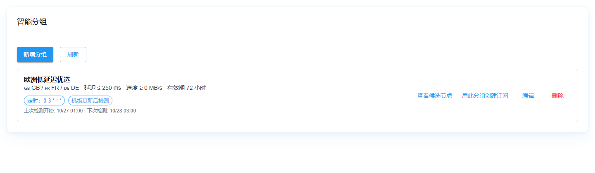
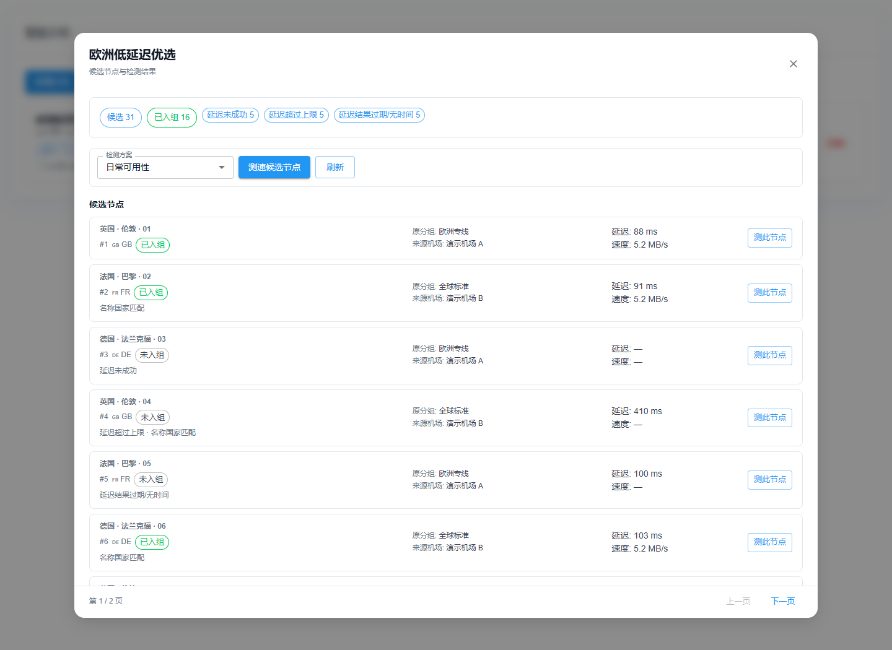
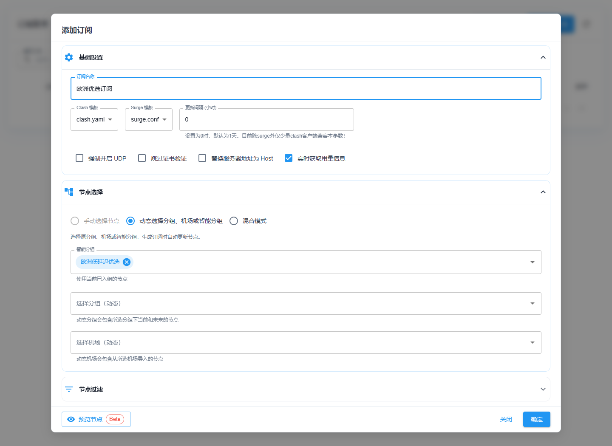

# Smart groups

[简体中文](smart-groups.zh-CN.md)

Smart groups are **independent dynamic views**, not replacements for source groups. A node keeps its original `Group`, and the same node can match multiple smart groups. A candidate matches when **any one** condition holds: its stored landing country (`LinkCountry`) is selected; its original/display name matches a selected country's configured rule or a standalone two-letter country code; or its name contains the optional case-insensitive keyword. These conditions are OR alternatives—even if the stored country differs from the name clue. A selected source-group restriction is still AND, and healthy membership still requires the configured successful checks. Name matching never rewrites the stored landing country or verifies the landing IP.

## When to use it

- **One regional pool across several airports:** collect GB/FR/DE nodes from different providers without changing their original groups.
- **A health-filtered subscription:** require a successful latency check, optionally set a speed floor, and automatically exclude failed or stale results.
- **Prepare nodes before a client refresh:** schedule checks before OpenClash or another independent client downloads its subscription. SublinkPro does not control the client.
- **Find out why a node is missing:** inspect all candidates, their source airport, match evidence and first exclusion reason, then retest a single node or the whole candidate set.

## Screenshots

These screenshots use synthetic demonstration airports and nodes, not production subscription data. They illustrate the UI, not measured network performance.

## Country matching is separate from protocol

Selecting a country/flag never selects a protocol. Exact flags (for example `🇹🇷`) and standalone ISO tokens (`TR`) match names even without a saved country rule. In smart-group name rules, plain two/three-letter alternatives are matched with ASCII-letter boundaries: `TR` does not match `trojan`, `ES` does not match `vmess`/`vless`, and `IN` does not match `Singapore`. Full country names, flags and explicit custom regex branches keep their behavior. This applies immediately to existing rule definitions without rewriting them; general country-rule testing/import behavior is unchanged.

The existing OR relationship between stored country, name-country clues and an explicitly entered keyword is retained. A keyword such as `trojan` deliberately matches node names containing it; it is not a protocol-field filter. A genuine Turkish node can use any protocol. Already-saved `LinkCountry` values remain authoritative country alternatives and are not automatically corrected: if an earlier name-based fill incorrectly saved `TR`, verify the landing country and correct that node's metadata. New matching does not rewrite node data.

## Use

1. In **Subscriptions → Smart Groups**, create a group, choose countries from the full searchable region catalog (including PH), optionally specify an alternative node-name keyword and a restricting set of source groups, and set a maximum latency, minimum speed, and freshness window (default: 72 hours). Leave source groups empty to search across all original groups; new groups default to no latency ceiling. Zero for a numeric threshold means no upper/lower threshold; zero freshness disables expiry.
2. Click **View candidates** to open the candidate dialog. It shows all matching nodes, even before any test, with per-node availability or the first exclusion reason and a candidate/healthy summary. Inside the dialog choose an existing **Detection plan** and click **Check candidates** to test all, or **Check node** on a single row. The whole-group action asynchronously tests *all matching* nodes (country OR name/keyword, AND optional source groups), including failed or untested nodes; the row action tests only that candidate. A TCP profile is sufficient when minimum speed is zero; choose a mihomo download-speed profile when minimum speed is positive. The dialog listens for completed speed-test tasks to refresh; use **Refresh** if the task event was missed or the dialog was reopened.
3. A node becomes a member when its latency check succeeded with a positive delay, satisfies the optional latency ceiling, and (unless freshness is zero) has a recent latency timestamp. If minimum speed is positive, the speed check must also have succeeded, meet the minimum and have a recent timestamp. Membership is evaluated on each read. Stale or failed nodes leave the view automatically.
4. On a smart group card, click **Create subscription from group** to open a new subscription with that group preselected. Alternatively, add or edit a subscription and select smart groups directly in **Node selection**; the selector is visible even in Manual mode and automatically switches to Dynamic (or Mixed when manual nodes are already selected). You can add the same smart group to an existing subscription by editing it. The subscription list shows a separate smart-group count, not a physical source-group/node count. The subscription resolves current members when generated; its existing filtering and effective-name deduplication still apply. Direct/group/airport items precede smart-group members in the output. Preview reflects the same member criteria.

Deleting a smart group used by a subscription is rejected until it is removed from that subscription. Manual and automatic candidate checks use a profile for its test settings, not its saved group/tag scope.

The member endpoint returns `candidateCount` (before health filtering), `statusCounts` (mutually exclusive reasons for candidate exclusion), all healthy member IDs, a first-100 healthy display sample (`nodes`), and paginated `candidateNodes` (query `page`, `pageSize`, default 30, maximum 100). Each candidate includes `airportId` / `airportName` from its original source airport (separate from its original `group`), plus its first exclusion `reason`, latency and speed states, and `includedBySmartGroup` (true exactly when the reason is empty). An empty airport with ID 0 is a manual node; a nonzero ID with no name indicates a deleted source airport. The dialog labels candidates as Included / Excluded according to the current smart-group rules. Final subscription output can still change due to subscription-level filters, scripts, and effective-name deduplication, so this is not a promise that a given node appears in every subscription. The dialog paginates compact candidate rows with a single content scroller (full-screen on mobile); it does not hide untested or failed nodes. A short status badge, exclusion reason, original group and airport, delay/speed, and per-node check action remain visible without a horizontally scrolling nine-column table. Display samples include `countrySource: "stored" | "name"` and `matchSource: "landingCountry" | "countryName" | "keyword"`. A node can show its real stored country (e.g. GB) yet match a PH group by its name; this does **not** claim a PH landing IP. If candidates are zero, check stored `LinkCountry`, country-name rules and keyword/source-group filters; if only members are zero, the UI lists counts for failed/missing checks, threshold failures and expired/missing test timestamps. Subscription-wide country whitelist/blacklist filters are applied afterward to the node's stored `LinkCountry`, so a name-only country match may still be excluded by such a whitelist. The check endpoint accepts an optional `nodeId` for one matching candidate; omitted or zero tests all. The country chooser lists regions even if no node currently has that code. Batch-filling country from names updates the node cache immediately. No physical node group is created or moved.

## Automatic checks

Edit a group and configure **Automatic checks**:

- Select a **Default detection plan**. Its own schedule does not need to be enabled. Zero minimum speed accepts TCP; positive minimum speed requires a mihomo download-speed profile. Referenced profiles cannot be deleted until the saved references are cleared/changed. A profile used by an automatic group with a positive minimum speed cannot be changed to TCP.
- Enable **Scheduled checks** with a five-field Cron (`minute hour day month weekday`), e.g. `0 3 * * *` for daily 03:00. Saving hot-replaces the plan; disable/delete removes it, startup/reload restores it. Existing groups default to both automatic switches off.
- Optionally enable **Check after airport updates**. A successful airport refresh checks only the intersection of that airport's current nodes and each group's candidates, including unchanged, failed and untested nodes. Other airports/non-matching nodes are not checked. Same-profile groups share a deduplicated node list within one update batch. Failed refreshes do not trigger it.

Cron uses **the SublinkPro server/container's local timezone**, not browser/OpenWrt time. The card shows the server-calculated next run and the editor states the server timezone offset; the shared Cron editor preview uses browser time. Verify the deployment timezone before scheduling.

A group cannot overlap manual, Cron and airport-update checks: manual overlap returns HTTP 409, Cron overlap skips. Airport updates during a check are coalesced and queued for a follow-up using fresh configuration/candidates, including nodes added meanwhile. Empty candidates skip—never fall back to profile scope or all nodes. This protection is **per group**, not a global node lock: different groups, standalone profiles and the airport's existing **post-update check** can still check the same nodes. The airport setting remains independent; avoid enabling both paths for identical nodes/profile unless repeated checks are intended.

Results update dynamic membership through the existing node-check pipeline; no nodes are moved/copied. **Last check started** means the last candidate-check start, not completion or universal success. Use task progress/history and candidate exclusion reasons for actual results. List/create/update responses and members' `checkInfo` include read-only `lastCheckAt`, `nextCheckAt`, `checkRunning`, and `checkTimezone`. The page refreshes on task completion and polls automatic state while open.

### Preparing before an external subscription refresh

For example, if OpenClash refreshes at 04:00, schedule airport updates at 02:30 with airport-update linkage, and optionally a full-group check at 03:00. Allow enough time for node count, concurrency and timeouts; these sample times do not guarantee completion. Set freshness longer than the check interval plus your refresh buffer. OpenClash stays independent on OpenWrt: SublinkPro **does not control or wait for it**. Subscription requests read current passing members without starting a check or waiting for an active one.

## Detection-center jobs

You can also create independent jobs in the [Detection center](unlock-check.md#detection-center), reuse a plan, target this group's candidates and optionally update selected airports first. Avoid enabling duplicate automation paths for the same nodes. AI service results remain independent check results; existing smart-group membership does not automatically acquire AI eligibility rules.
