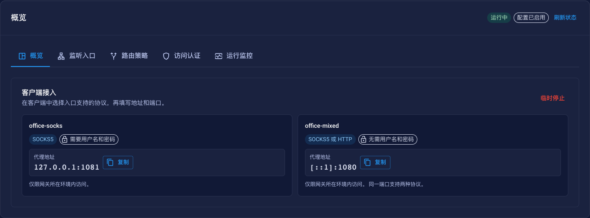
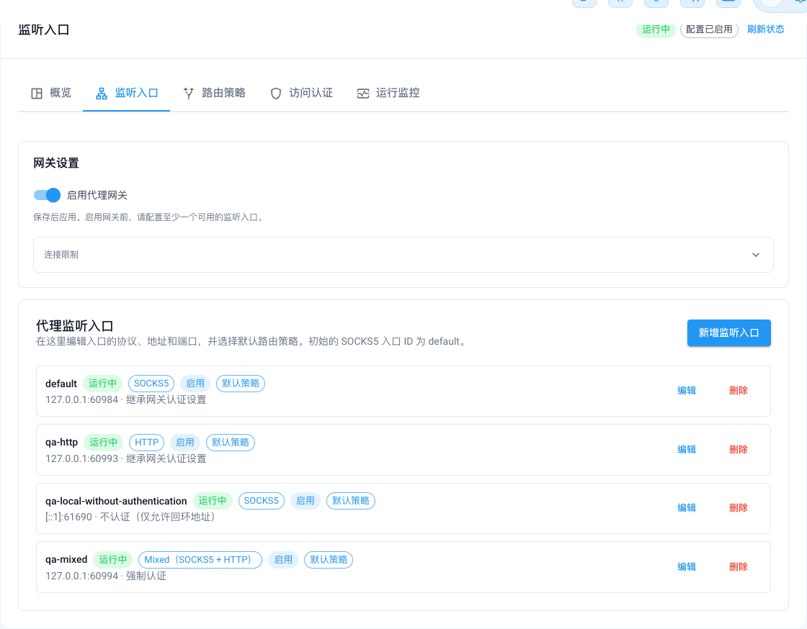
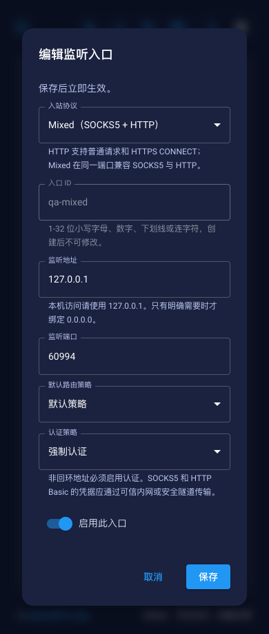
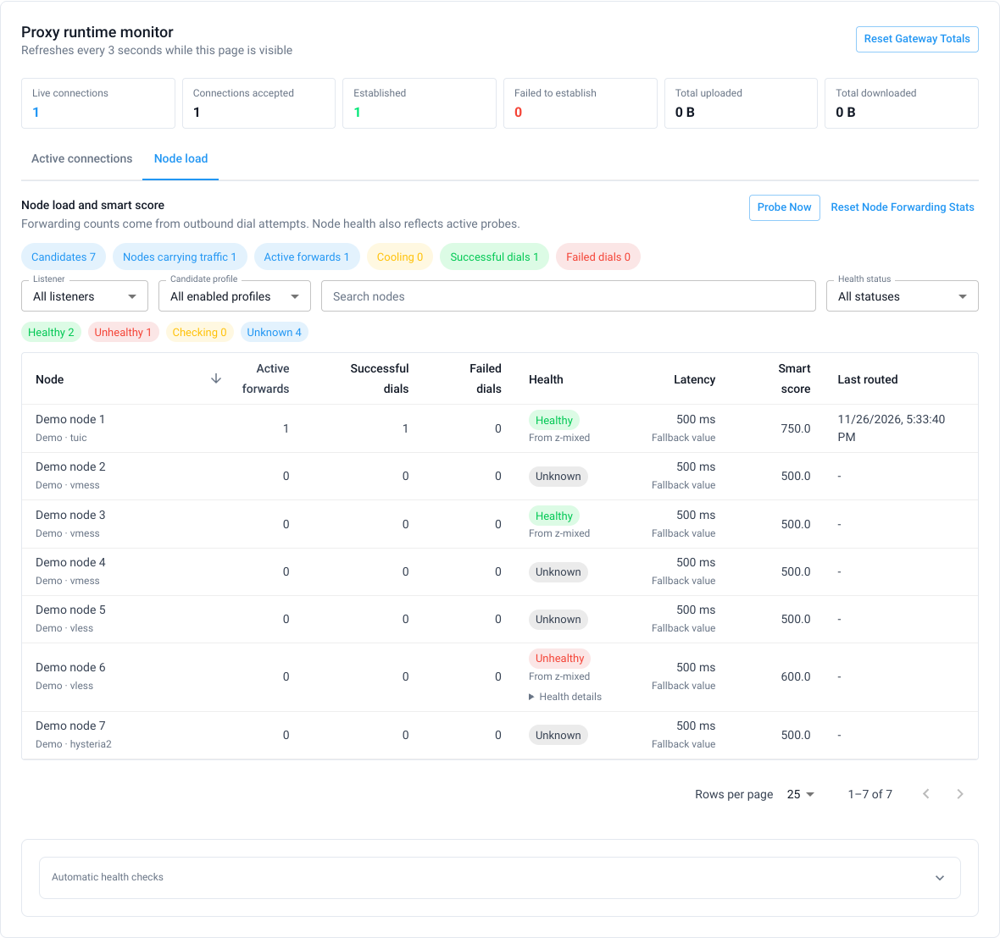

English | [简体中文](socks5.zh-CN.md)

# Proxy Gateway

SublinkPro can expose selected stored proxy nodes through local SOCKS5, HTTP, or Mixed listeners. This is separate from the existing SOCKS5 node import/export support.

## What is included

- SOCKS5 TCP `CONNECT`, HTTP/1.x forward proxy requests and HTTPS `CONNECT` tunnels
- Mixed listeners accept SOCKS5 and HTTP on the same TCP port
- IPv4, IPv6, and domain targets
- Optional username/password authentication (enabled by default)
- Independent SOCKS5 accounts with separate encrypted passwords and direct routing-profile binding
- Multiple listener addresses/ports with stable IDs, per-listener default profiles, and optional authentication-policy overrides
- Best-node, random-node, round-robin, smart P2C, or specific-node selection
- Candidate node pools filtered by groups, sources, protocols, countries/regions, and node tags. Fields combine with AND, and values within a field combine with OR.
- Optional in-memory sticky sessions keyed by client IP or authenticated SOCKS5 username, with a 60-604800 second sliding TTL
- Multiple routing profiles with independent candidate pools, selection strategies, retries, cooldown, and sticky-session settings
- Backward-compatible username routing: `username`, `username@profile`, or `username@profile.account`
- Mihomo outbound adapter pooling keyed by node ID and link hash, with an idle LRU cap
- Configurable per-request retry (up to 5 candidate nodes), dial timeout, and failed-node cooldown
- Optional fallback from a specific node; disabled by default to keep specific routing strict
- Per-listener active-connection limit (`maxConnections`, default `256`, range `1-10000`)
- Per-client-IP active-connection limit within each listener (`maxConnectionsPerClient`, default `32`, range `1..maxConnections`)
- Idle timeout (`idleTimeoutSeconds`, default `600`, range `0-86400`; `0` disables it)
- Maximum connection duration (`maxConnectionDurationSeconds`, default `0`, range `0-604800`; `0` disables it)
- Administrator-only live monitoring with active/total/success/failure counters and upload/download byte counters
- Administrator controls to disconnect one active connection or all active connections
- Optional active node health checks with a fixed HTTPS probe target, bounded concurrency, latency reporting, exponential failure cooldown, and manual probe control
- Server-paginated node load visualization with search, health filtering, sorting, active connections, success/failure totals, latency sources, and live smart scores
- Runtime-stat reset controls that preserve active connections while clearing per-node historical counters
- Health-aware routing: active-probe failures are removed from normal candidate sets, and `best` prioritizes fresh active-probe latency before applying the retry limit
- Runtime start/stop when settings are saved; no process restart is required

The saved address and port provide the initial SOCKS5 listener, `default`. Edit it directly in Listeners. Gateway routing settings provide the non-deletable `default` routing policy. With the shared password, `username` uses the listener’s default policy. `username@japan` selects the enabled policy with the ID `japan` and uses client-IP affinity when sticky sessions are enabled. `username@japan.user01` selects the same policy and uses `user01` as the client identifier for affinity. Independent accounts use their own password and are bound to one enabled policy. The gateway checks exact independent usernames before parsing the shared username. Disabled or missing profiles fail authentication, and profile routing requires username/password authentication. Round-robin counters and sticky leases are isolated by profile inside each listener runtime. Connection IDs include the listener ID and gateway counters are aggregated across listeners.

Smart routing uses power-of-two choices for the first attempt, combining active-probe latency (or stored delay), active connection load, and consecutive failure penalties; remaining retry candidates are score-ordered. Sticky hits remain first and smart scoring applies to their fallbacks. Retries happen before the SOCKS5 success reply is sent. Active-probe failures are skipped while another routable candidate exists; if every candidate is unhealthy, routing fails open and keeps candidates available for recovery. A successful real connection clears the routing exclusion without erasing the most recent active-probe latency. A failed adapter is discarded, and adapters are closed when the gateway is stopped or reapplied. If every candidate is cooling down, the node whose cooldown expires first is probed so the pool cannot remain permanently unavailable.

UDP `ASSOCIATE` and `BIND` are not included yet. Sticky leases and per-node routing statistics are in-memory and reset whenever the gateway is stopped or settings are reapplied. The administrator monitor includes live connection controls plus a paginated candidate-node load table; resetting node statistics does not interrupt active connections.

## Configure

1. Sign in as an administrator and open **System Settings → Proxy gateway** (`/system/proxy-gateway`). The overview shows the saved enable setting, current runtime state, and the next setup action. Each listener lists its protocols, effective authentication requirement, and connection address.
2. Set the shared username and password under **Access → Shared authentication**. Independent accounts can each have their own password and be assigned to an enabled routing policy.
3. Check the protocol, address, port, and enabled setting for each entry under **Listeners**. For local access, use a loopback address such as `127.0.0.1:1080`. Expand **Connection limits** to adjust capacity and timeouts.
4. Choose the default node selection and candidate pool under **Routing**, or create a policy for particular listeners or accounts. Retry, cooldown, and sticky-session settings are under **Advanced routing**.
5. Turn on **Enable proxy gateway** and choose **Save and apply**. The gateway settings draft is shared across tabs. Edits to individual listeners, custom policies, and accounts take effect when saved in their dialogs.
6. Return to **Overview** for client connection details. **Stop temporarily** disconnects current connections and keeps the saved enable setting. **Resume gateway** uses the saved configuration. To keep the gateway disabled, turn off the enable setting and save.
7. Use **Monitor** to inspect active connections or node load. Automatic health-check settings and the manual probe are in the node load view.

In either policy editor, choose system **Tags** in the candidate node pool. The dropdown stays open as you select values, and tags use their configured colors. A node must have at least one selected tag, matching its full name and letter case, and satisfy the other active filters. Leave **Tags** empty to include nodes regardless of their tags. With specific-node selection and fallback enabled, the filter applies to the fallback pool.

The gateway is disabled by default. Passwords are encrypted with the instance API encryption key. Settings responses expose `hasPassword` and, when present, `maskedPassword`; plaintext `password` is never returned. Omitting `password` preserves the saved password, while `clearPassword: true` clears it.

## Use

```bash
curl --proxy socks5h://127.0.0.1:1080 \
  -U "admin:your-password" \
  https://api.ipify.org
```

If you bind to `0.0.0.0` or another non-loopback address, authentication is mandatory. Expose the port only behind a firewall or private network and use a strong password. The backend rejects unauthenticated non-loopback listeners to prevent accidental open proxies.

## HTTP and Mixed listeners

In **Proxy gateway → Listeners**, add or edit an entry and choose **Inbound protocol**:

- **SOCKS5** preserves existing behavior.
- **HTTP** accepts absolute-form `http://` requests and HTTPS `CONNECT` tunnels. Each keep-alive request is independently authenticated and routed; different hosts/accounts do not reuse an earlier request's outbound connection.
- **Mixed** accepts either protocol on one port. Do not create two listeners for the same address/port.

Choose a default routing profile and authentication policy as before. The legacy/default entry starts as SOCKS5; editing it through the listener list can persist another protocol. Missing protocol on old stored entries or new API requests defaults to `socks5`; an old client's update that omits protocol preserves the existing selection. Unknown protocol values are rejected. Protocol settings are stored in the existing listener JSON; no new environment variable or independent proxy process is required. The page is at `/system/proxy-gateway` and the management API uses `/api/v1/proxy-gateway`.

For a Mixed listener configured on `127.0.0.1:7890`:

```bash
# Plain HTTP and HTTPS websites via the HTTP proxy
curl --proxy http://127.0.0.1:7890 -U 'proxy:your-password' http://example.com
curl --proxy http://127.0.0.1:7890 -U 'proxy:your-password' https://example.com
# The same port also accepts SOCKS5
curl --proxy socks5h://127.0.0.1:7890 -U 'proxy:your-password' https://example.com
```

For tools using `HTTP_PROXY`/`HTTPS_PROXY`, the proxy address is `http://127.0.0.1:7890` in both cases. HTTPS websites travel through CONNECT without decryption; this is not TLS on the proxy listener itself. HTTP Basic and SOCKS5 authentication do not encrypt credentials: keep non-loopback endpoints behind a firewall/private network or secure tunnel. Usernames containing `:` remain usable over SOCKS5 but cannot be represented by HTTP Basic; use a separate compatible account for HTTP/Mixed clients. `username@profile[.account]` and independent accounts use the same profile rules on both protocols. A failed HTTP authentication receives `407` and cannot select or dial a node.

Retries only switch nodes during outbound dialing, before request bytes are sent. A POST/upload or a partially received response is never automatically replayed on another node; origin HTTP error status codes are not treated as node dial failures. Proxy authentication headers are consumed locally and never forwarded to the origin. Upgrades/WebSocket, HTTP/2 inbound, UDP/BIND, and TLS-encrypted proxy listeners are not supported.

Monitoring distinguishes a listener's configured `mixed` mode from actual SOCKS5/HTTP sessions, including CONNECT. Active limits and gateway totals count client TCP connections, not keep-alive requests. A TCP connection is successful after at least one normal response or successful tunnel establishment; an unsuccessful later request does not count that same TCP connection again. Per-node counters reflect outbound connection attempts. For ordinary HTTP, byte counters measure forwarded request/response bodies; for tunnels they measure payload, not authentication/HTTP framing. On a keep-alive session, the target/profile/node describe its latest request; `idle` means waiting for the next request. Disconnect, idle/duration limits and stop/reapply cover HTTP and hijacked CONNECT sessions too. Clean tunnel half-close drains the reverse direction when the underlying transport supports it; unsupported transports retain full-close behavior.

### Interface previews

These previews show temporary listeners in an isolated test instance.









[View the runtime monitor in dark mode](../images/proxy-gateway/monitor-dark.png)

## Backup and restore

Database migration and WebDAV restore preserve the target instance's SOCKS5 configuration, accounts, listeners, and routing profiles. This avoids importing credentials encrypted with another instance's key or unexpectedly opening network listeners. Active connections are disconnected and gateway state is reloaded after restore; review node IDs and candidate pools against the restored nodes.

Connection limits apply separately to each listener. The monitor totals connections and traffic across all running listeners. Node load opens on all running listeners and the candidates from all enabled profiles. Select a listener to inspect its counters and health. Selecting a candidate profile narrows the list of nodes. Their counters reflect all traffic to those nodes in the selected listeners. SOCKS5 itself does not add TLS, so non-loopback listeners should remain behind a firewall or trusted private network.

## API

All endpoints below require an authenticated administrator. The destructive `POST`/`DELETE` operations are also restricted in demo mode.

The old `/api/v1/settings/socks5` prefix returns `404`. Use `/settings` under the new prefix for configuration. The former `/profiles`, `/routing`, and `/routing/reset` move to `/routing-profiles`, `/node-stats`, and `/node-stats/reset`. Read the enabled flag from `status.data.enabled`, saved settings from `/settings`, and per-node health records from `/health`.

- `GET /api/v1/proxy-gateway/settings` — read public gateway settings; the plaintext password is never returned.
- `POST /api/v1/proxy-gateway/settings` — save and apply settings. JSON fields include `enabled`, `listenAddress`, `port`, `username`, optional `password`, `clearPassword`, `nodeId`, `selection` (`best`, `random`, `round_robin`, `smart`, or `specific`), `requireAuth`, `maxAttempts` (1-5), `dialTimeoutSeconds` (1-120), `failureCooldownSeconds` (0-3600), `specificFallback`, `maxConnections` (1-10000), `maxConnectionsPerClient` (1..maxConnections), `idleTimeoutSeconds` (0-86400), `maxConnectionDurationSeconds` (0-604800), `healthCheckEnabled`, `healthCheckIntervalSeconds` (10-3600), `healthCheckTimeoutSeconds` (1-30), `candidateGroups`, `candidateSources`, `candidateProtocols`, `candidateCountries`, `candidateTags`, `stickySessionEnabled`, `stickySessionMode` (`client_ip` or `username`), and `stickySessionTtlSeconds` (60-604800). Candidate pool fields are string arrays; fields are combined with AND and values within each field use OR. Optional fields may be omitted to preserve saved values. `listenAddress` and `port` define the initial listener. Edit saved listeners through `/listeners`. If applying the saved settings fails, the application error includes the latest saved public configuration in `data.settings`.
- `POST /api/v1/proxy-gateway/start` — use the saved configuration to resume the gateway. The gateway and at least one listener must be enabled.
- `POST /api/v1/proxy-gateway/stop` — stop listening and keep the saved settings. Both operations return the same shape as the status endpoint.
- `GET /api/v1/proxy-gateway/status` — return `data.enabled`, `data.running`, `data.listeners`, aggregate connection and traffic counters in `data.stats`, and aggregate probe data in `data.health`. Running listeners include their effective authentication setting in `effectiveRequireAuth`.
- `GET /api/v1/proxy-gateway/health` — return health deduplicated across running listeners and up to 200 per-node health records with their source listener.
- `GET|POST /api/v1/proxy-gateway/listeners` — list or create listeners. Listener fields are `id`, `protocol` (`socks5`, `http`, or `mixed`), `enabled`, `listenAddress`, `port`, `defaultProfileId`, and nullable `requireAuth` (null inherits the gateway setting).
- `PUT|DELETE /api/v1/proxy-gateway/listeners/:id` — replace or delete a listener. Listener IDs and enabled endpoints must be unique. A failed bind rolls the saved listener list back.
- `GET|POST /api/v1/proxy-gateway/accounts` — list or create independent accounts. Account fields are `id`, `username`, `password`, `profileId`, and `enabled`; responses expose only password-presence metadata.
- `PUT|DELETE /api/v1/proxy-gateway/accounts/:id` — replace or delete an account. An empty update password retains the encrypted saved password.
- `GET /api/v1/proxy-gateway/routing-profiles` — list the virtual `default` profile plus saved custom routing profiles.
- `POST /api/v1/proxy-gateway/routing-profiles` — create a custom profile. Fields include `id`, `name`, `enabled`, `selection`, `nodeId`, retry/cooldown values, candidate-pool arrays (including `candidateTags`), and sticky-session settings.
- `PUT /api/v1/proxy-gateway/routing-profiles/:id` — replace an existing custom profile. The reserved `default` profile is managed through the gateway settings endpoint.
- `DELETE /api/v1/proxy-gateway/routing-profiles/:id` — delete a custom profile; existing established connections are not interrupted.
- `GET /api/v1/proxy-gateway/node-stats` — return a server-paginated candidate-node load page. Omit `listenerId` for all running listeners. Use `allProfiles=true` for all enabled profiles or `profileId` to select a candidate pool (defaults to `default`). Other query parameters are `keyword`, `status` (`healthy`, `unhealthy`, `checking`, `cooling`, or `unknown`), `sortBy`, `sortOrder`, `page`, and `pageSize` (maximum `100`). Items include node metadata, health state, latency source, active/success/failure counters, consecutive failures, smart score, cooldown, and last-routed time. `healthListenerId` identifies the source for health, latency, and smart score. `probeRunning` shows whether a sweep is running on any selected listener.
- `POST /api/v1/proxy-gateway/stats/reset` — clear gateway-wide connection counts and upload/download totals. For an open connection, only its traffic after the reset contributes to the new totals.
- `POST /api/v1/proxy-gateway/node-stats/reset` — clear successful and failed outbound dials and last-routed times across all running listeners. Active forwards and node health remain available.
- `POST /api/v1/proxy-gateway/health/probe` — start an immediate health sweep. Pass `listenerId` or `profileId` to target the selected listener or candidate pool. Each listener runs at most one sweep at a time.
- `GET /api/v1/proxy-gateway/connections` — return the current active connection array. Each item includes `id`, `clientAddress`, `target`, `nodeName`, `profileId`, `profileName`, optional `account`, optional `listenerId`, `protocol` (actual `socks5` or `http`; briefly `mixed` or empty before protocol identification), optional `method` (e.g. `CONNECT`), `phase`, `startedAt`, `lastActivity`, `uploadBytes`, and `downloadBytes`.
- `DELETE /api/v1/proxy-gateway/connections/:id` — disconnect one active connection by ID.
- `DELETE /api/v1/proxy-gateway/connections` — disconnect all active connections.

The status counters, per-node routing statistics, active connection list, and sticky leases belong to the current gateway server lifetime; stopping or reapplying settings resets them. The routing endpoint performs filtering, sorting, and pagination on the server so three-second UI refreshes render only the requested page.

Active health checks probe the deduplicated union of candidate nodes from every enabled routing profile. Strict specific-node profiles contribute only their configured node; profiles with specific-node fallback contribute that node plus their configured fallback pool. Other profiles contribute their configured candidate pool. Probes use a fixed Cloudflare HTTPS connectivity endpoint; administrators cannot configure an arbitrary probe URL. Sweeps use at most four workers and never overlap. Status responses include aggregate counts. The health endpoint returns up to the first 200 sorted node records. Failed probes retire the failed adapter lease safely and apply exponential cooldown capped at one hour.
