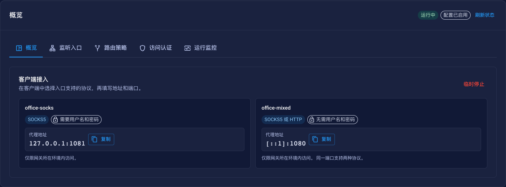
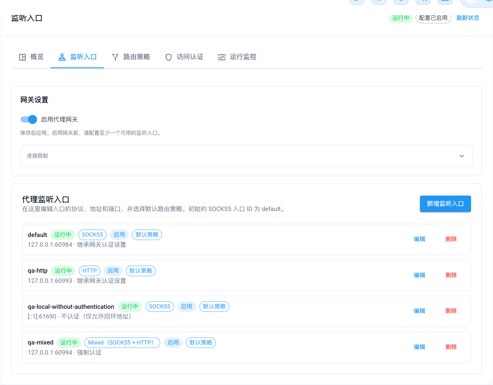
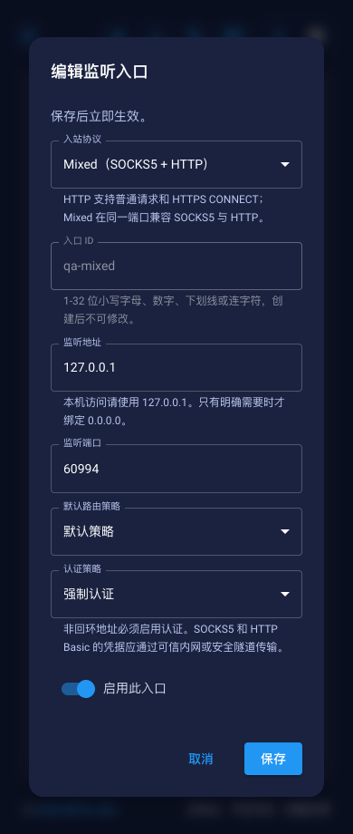
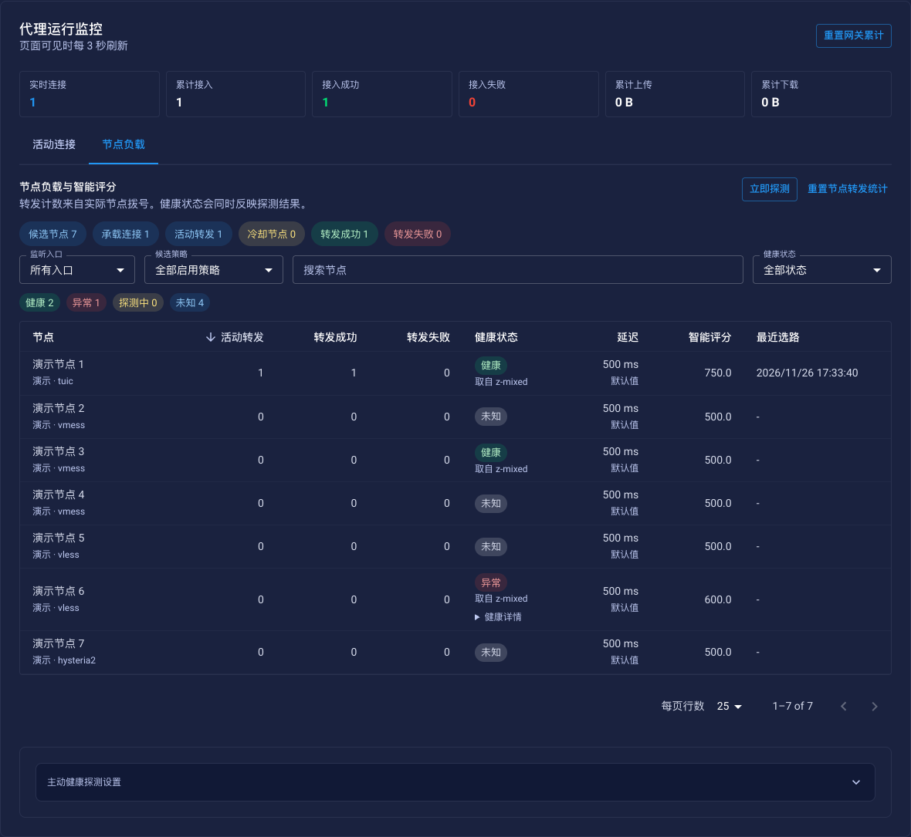

[English](socks5.md) | 简体中文

# 代理网关

SublinkPro 可以将已保存的代理节点通过本地 SOCKS5、HTTP 或 Mixed 监听入口暴露出来。该功能与现有的 SOCKS5 节点导入/导出能力不同。

## 当前包含

- 支持 SOCKS5 TCP `CONNECT`、HTTP/1.x 普通代理请求和 HTTPS `CONNECT` 隧道
- Mixed 入口在同一 TCP 端口接收 SOCKS5 与 HTTP
- 支持 IPv4、IPv6 和域名目标
- 可选用户名/密码认证（默认启用）
- 支持独立 SOCKS5 账号，每个账号拥有单独加密密码并直接绑定路由 Profile
- 支持多个监听地址/端口，监听器具有稳定 ID、默认路由 Profile 和可选认证策略覆盖
- 支持最佳节点、随机节点、轮询节点、P2C 智能负载均衡或指定节点选择
- 支持按分组、来源、协议、国家/地区和节点标签组合过滤候选节点池。不同条件之间为“且”，同一条件内多个值为“或”。
- 支持可选的内存粘性会话，可按客户端 IP 或已认证的 SOCKS5 用户名绑定，滑动 TTL 范围为 60-604800 秒
- 支持多个路由 Profile，每个 Profile 可独立配置候选节点池、选路策略、重试、冷却和粘性会话
- 支持按共享用户名选择路由策略：`username`、`username@profile` 或 `username@profile.account`
- 按节点 ID 和链接哈希缓存复用 mihomo 出站适配器，并限制空闲 LRU 缓存规模
- 支持每次请求最多 5 个候选节点重试、拨号超时和失败节点冷却
- 指定节点可选失败回退；默认关闭，保持指定节点路由严格性
- 每个监听入口的活动连接上限（`maxConnections`，默认 `256`，范围 `1-10000`）
- 每个监听入口内的单客户端 IP 活动连接上限（`maxConnectionsPerClient`，默认 `32`，范围 `1..maxConnections`）
- 空闲超时（`idleTimeoutSeconds`，默认 `600`，范围 `0-86400`；`0` 表示禁用）
- 单连接最大持续时间（`maxConnectionDurationSeconds`，默认 `0`，范围 `0-604800`；`0` 表示禁用）
- 仅管理员可见的实时监控，展示活动/累计/成功/失败连接数及上下行字节数
- 仅管理员可执行断开单条活动连接或断开全部连接
- 可选节点主动健康探测，提供固定 HTTPS 探测目标、受控并发、延迟统计、指数失败冷却和手动立即探测
- 提供服务端分页的节点负载表，支持搜索、健康状态筛选、排序，并展示活动连接、成功/失败次数、延迟来源和实时智能评分
- 支持重置节点运行统计；清空逐节点历史计数时不会中断活动连接
- 健康感知选路：主动探测失败的节点会退出正常候选集，`best` 会在截取重试节点前优先使用最新主动探测延迟排序
- 保存设置后即时启动/停止，无需重启进程

系统会根据已保存的地址和端口生成初始 SOCKS5 入口 `default`。可以直接在「监听入口」中编辑它，无需迁移已有配置。网关的默认选路设置会形成不可删除的 `default` 路由策略。使用共享密码时，客户端填写 `username` 会使用当前入口的默认策略。`username@japan` 选择 ID 为 `japan` 的已启用策略，并在启用粘性会话时按客户端 IP 保持出口。`username@japan.user01` 选择同一策略，并使用 `user01` 作为粘性会话的客户端标识。独立账号使用各自的密码，并直接绑定一个已启用的路由策略。系统会先匹配独立账号，再解析共享用户名。禁用或不存在的 Profile 会导致认证失败；使用多 Profile 选路必须开启用户名/密码认证。轮询计数和粘性租约在每个监听器运行时内按 Profile 隔离；连接 ID 会包含监听器 ID，网关连接统计则会跨监听器聚合。

智能选路会用 P2C 选择首次尝试节点，综合主动探测延迟（或节点已存延迟）、活动连接负载和连续失败惩罚；其余重试节点按评分排序。粘性命中仍保持第一优先级，智能评分用于回退节点。所有自动切换均发生在发送 SOCKS5 成功响应之前。主动探测失败的节点会在仍有其他可路由节点时被跳过；若全部候选都异常，则采用 fail-open 方式保留候选以便恢复。真实连接成功会解除节点的选路排除状态，同时保留最近一次主动探测延迟。拨号失败的适配器会被丢弃，停止或重新应用网关配置时会关闭适配器池。如果全部候选节点都处于冷却状态，系统会探测最早到期的节点，避免节点池永久不可用。

目前仍不包含 UDP `ASSOCIATE` 和 `BIND`。粘性租约和逐节点选路统计仅保存在内存中，停止网关或重新应用设置后会清空。管理员监控页面同时提供实时连接控制和分页候选节点负载表；重置节点统计不会中断活动连接。

## 配置

1. 使用管理员账号，在侧边栏打开 **系统设置 → 代理网关**（`/system/proxy-gateway`）。概览会显示配置是否已启用、实际运行状态和下一步操作。每个入口分别列出可用协议、实际认证要求和接入地址。
2. 在**访问认证 → 共享认证**设置用户名和密码。每个独立账号可以保存自己的密码并绑定已启用的路由策略。
3. 在**监听入口**确认要启用的入口、协议、地址和端口。本机使用时保留回环地址，例如 `127.0.0.1:1080`。如需调整连接数与超时，展开**连接限制**。
4. 在**路由策略**选择默认节点和候选池，或添加供特定入口、账号选用的策略。重试、冷却与粘性会话位于**高级选路**。
5. 勾选**启用代理网关**并选择**保存并应用**。全局设置的草稿可跨标签编辑。入口、自定义策略和账号在各自的编辑弹窗保存后立即生效。
6. 回到**概览**查看客户端接入信息。**临时停止**断开当前连接并保留启用设置，**恢复运行**使用已保存的配置重新监听。长期停用可关闭启用开关并保存。
7. 在**运行监控**查看活动连接或节点负载。主动健康探测设置与立即探测操作位于节点负载视图。

默认策略和自定义策略都可以在候选节点池选择系统**标签**。下拉框保持展开，可以连续选择，标签显示系统中为其配置的颜色。节点需要匹配任意一个选中标签的完整名称及大小写，并满足其他筛选条件。标签留空时不限制节点标签。指定节点失败回退开启时，标签条件应用于回退节点池。

网关默认关闭。密码使用实例 API 加密密钥加密保存。设置响应仅返回 `hasPassword` 及（有密码时）`maskedPassword`，不会返回明文 `password`。省略 `password` 会保留已保存密码，`clearPassword: true` 会清除密码。

## 使用

```bash
curl --proxy socks5h://127.0.0.1:1080 \
  -U "admin:your-password" \
  https://api.ipify.org
```

如果绑定到 `0.0.0.0` 或其他非回环地址，系统会强制要求认证。请只在防火墙或私有网络后开放，并使用强密码；后端会拒绝未认证的非回环监听，避免意外形成开放代理。

## HTTP 与 Mixed 监听入口

在**代理网关 → 监听入口**中新增或编辑条目，选择**入站协议**：

- **SOCKS5**：保留原有行为。
- **HTTP**：接收目标为完整 `http://` URL 的普通请求，以及 HTTPS `CONNECT` 隧道。同一长连接的每个请求都会重新认证、选路，不会因上次请求而把另一个网站或账号发到错误出口。
- **Mixed**：同一端口接收两种协议；不要为相同地址和端口创建两条监听器。

默认路由配置与认证策略仍按入口设置。旧默认入口继续使用 SOCKS5，也可通过监听入口列表编辑并保存其他协议。旧数据或新建请求缺失协议时默认 `socks5`；旧客户端更新入口时未传协议则保留当前选择，不会降级 HTTP/Mixed。未知协议值会拒绝保存。协议保存在监听入口配置中。网页入口为 `/system/proxy-gateway`，管理 API 使用 `/api/v1/proxy-gateway`。

假设已创建 `127.0.0.1:7890` 的 Mixed 入口：

```bash
# 通过 HTTP 代理访问普通 HTTP 与 HTTPS 网站
curl --proxy http://127.0.0.1:7890 -U 'proxy:your-password' http://example.com
curl --proxy http://127.0.0.1:7890 -U 'proxy:your-password' https://example.com
# 同一端口也接受 SOCKS5
curl --proxy socks5h://127.0.0.1:7890 -U 'proxy:your-password' https://example.com
```

使用 `HTTP_PROXY` / `HTTPS_PROXY` 的工具，两者的代理地址均填写 `http://127.0.0.1:7890`。HTTPS 网站通过 CONNECT 原样传输，不解密网站内容，也不代表代理入口本身启用了 TLS。HTTP Basic 与 SOCKS5 都不加密认证凭据，非本机入口应放在防火墙、可信内网或安全隧道后。用户名包含 `:` 的旧账号仍可用于 SOCKS5，但无法用 HTTP Basic 表达；HTTP/Mixed 客户端应换用不含冒号的账号。原 `username@profile[.account]` 语法和独立账号的路由规则在两种协议下一致；HTTP 认证失败返回 `407`，不会选取或拨号节点。

自动切换节点仅发生在出站拨号阶段，尚未发送请求数据；POST/上传已开始或响应已部分发送后不会换节点重放。目标网站返回的 HTTP 错误状态不视为节点拨号失败。代理认证头只在本地消费，不转发给目标网站。暂不支持 Upgrade/WebSocket、HTTP/2 入站、UDP/BIND 或代理入口自身的 TLS。

监控区分入口配置的 `mixed` 与连接实际使用的 SOCKS5/HTTP，并标明 CONNECT。连接上限及网关总计按客户端 TCP 连接计数，不按长连接请求次数累加；一条连接完成至少一次普通响应或成功建立隧道后计为成功，后续请求失败不会再次累计该 TCP 连接。逐节点统计按出站连接尝试计数。普通 HTTP 的流量统计为转发的请求/响应正文，隧道统计有效载荷，不包含认证或 HTTP 报头。长连接上的目标、路由配置和节点表示最近一次请求，`idle` 表示等待下一请求。断开、空闲/时长限制以及停止/重新应用设置也覆盖 HTTP 和 CONNECT 连接。底层传输支持半关闭时，隧道在一个方向结束后尽量传完反向数据；不支持时沿用双向关闭。

### 界面预览

以下截图使用隔离测试实例中的临时监听入口。









[查看浅色模式下的运行监控](../images/proxy-gateway/monitor-light.png)

## 备份与恢复

数据库迁移及 WebDAV 恢复会保留目标实例的 SOCKS5 网关配置、账号、监听入口与路由 Profile，避免导入由其他实例密钥加密的凭据或意外开放网络监听。恢复后会断开现有连接并重新加载网关；请按恢复后的节点检查节点 ID 和候选池。

每个监听入口分别应用连接数限制。运行监控汇总所有运行入口的连接数和流量。节点负载默认显示所有运行入口及全部启用策略的候选节点。可按入口查看各自的计数与健康状态。选择候选策略会缩小节点列表，计数涵盖所选入口发往这些节点的全部流量。SOCKS5 本身不提供 TLS，非回环监听应放在防火墙或可信内网后。

## API

以下接口均要求登录并且仅管理员可用；有写入风险的 `POST`/`DELETE` 接口在演示模式下也会被限制。

旧 API 前缀 `/api/v1/settings/socks5` 已下线，调用会返回 `404`。配置读写请改用新前缀下的 `/settings`，原 `/profiles`、`/routing` 和 `/routing/reset` 分别迁移到 `/routing-profiles`、`/node-stats` 和 `/node-stats/reset`。启用状态由 `status.data.enabled` 提供，完整配置与节点健康明细分别从 `/settings` 和 `/health` 读取。

- `GET /api/v1/proxy-gateway/settings` — 读取公开网关设置，不返回明文密码。
- `POST /api/v1/proxy-gateway/settings` — 保存并应用设置。JSON 字段包括 `enabled`、`listenAddress`、`port`、`username`、可选 `password`、`clearPassword`、`nodeId`、`selection`（`best`、`random`、`round_robin`、`smart` 或 `specific`）、`requireAuth`、`maxAttempts`（1-5）、`dialTimeoutSeconds`（1-120）、`failureCooldownSeconds`（0-3600）、`specificFallback`、`maxConnections`（1-10000）、`maxConnectionsPerClient`（1..maxConnections）、`idleTimeoutSeconds`（0-86400）、`maxConnectionDurationSeconds`（0-604800）、`healthCheckEnabled`、`healthCheckIntervalSeconds`（10-3600）、`healthCheckTimeoutSeconds`（1-30）、`candidateGroups`、`candidateSources`、`candidateProtocols`、`candidateCountries`、`candidateTags`、`stickySessionEnabled`、`stickySessionMode`（`client_ip` 或 `username`）和 `stickySessionTtlSeconds`（60-604800）。候选池字段均为字符串数组；不同字段之间为“且”，字段内多个值为“或”。可选字段均可省略以保留已保存值。`listenAddress` 和 `port` 用于生成初始入口，已保存的监听入口请通过 `/listeners` 编辑。保存后应用失败时，业务错误响应的 `data.settings` 返回最新已保存的公开配置。
- `POST /api/v1/proxy-gateway/start` — 使用已保存的配置恢复运行。网关须已启用，且至少有一个启用的监听入口。
- `POST /api/v1/proxy-gateway/stop` — 停止监听并保留已保存的设置。两个操作均返回与状态接口相同的结构。
- `GET /api/v1/proxy-gateway/status` — 返回 `data.enabled`、`data.running`、`data.listeners`、连接及流量汇总 `data.stats`、健康探测汇总 `data.health`。运行中的入口包含实际认证要求 `effectiveRequireAuth`。
- `GET /api/v1/proxy-gateway/health` — 返回跨运行入口去重的健康汇总与最多 200 条节点健康明细，并标明来源入口。
- `GET|POST /api/v1/proxy-gateway/listeners` — 列出或创建监听器。字段包括 `id`、`protocol`（`socks5` / `http` / `mixed`）、`enabled`、`listenAddress`、`port`、`defaultProfileId` 和可空的 `requireAuth`（null 表示继承网关设置）。
- `PUT|DELETE /api/v1/proxy-gateway/listeners/:id` — 覆盖更新或删除监听器。监听器 ID 和已启用的监听端点必须唯一；绑定失败时会回滚已保存的监听器列表。
- `GET|POST /api/v1/proxy-gateway/accounts` — 列出或创建独立账号。字段包括 `id`、`username`、`password`、`profileId` 和 `enabled`；响应只返回密码是否存在的元数据。
- `PUT|DELETE /api/v1/proxy-gateway/accounts/:id` — 覆盖更新或删除账号；更新时密码留空会保留已加密保存的密码。
- `GET /api/v1/proxy-gateway/routing-profiles` — 返回虚拟 `default` 配置和已保存的自定义路由配置。
- `POST /api/v1/proxy-gateway/routing-profiles` — 创建自定义路由配置。字段包括 `id`、`name`、`enabled`、`selection`、`nodeId`、重试/冷却参数、候选池数组（含 `candidateTags`）和粘性设置。
- `PUT /api/v1/proxy-gateway/routing-profiles/:id` — 覆盖更新自定义路由配置；保留的 `default` 配置由网关设置接口管理。
- `DELETE /api/v1/proxy-gateway/routing-profiles/:id` — 删除自定义路由配置；已经建立的连接不会被主动中断。
- `GET /api/v1/proxy-gateway/node-stats` — 返回服务端分页的候选节点负载数据。省略 `listenerId` 时汇总所有运行入口。用 `allProfiles=true` 查看全部启用策略的候选节点，或用 `profileId` 选择一个候选池（默认 `default`）。其他查询参数包括 `keyword`、`status`（`healthy`、`unhealthy`、`checking`、`cooling` 或 `unknown`）、`sortBy`、`sortOrder`、`page` 和 `pageSize`（最大 `100`）。每项包含节点元数据、健康状态、延迟来源、活动/成功/失败计数、连续失败、智能评分、冷却时间和最近选路时间。`healthListenerId` 标明健康状态、延迟和评分取自哪个入口。`probeRunning` 表示所选入口中是否有正在进行的探测。
- `POST /api/v1/proxy-gateway/stats/reset` — 清空网关累计接入、成功、失败及上传下载量。活动连接从重置时刻起重新计入网关流量。
- `POST /api/v1/proxy-gateway/node-stats/reset` — 清空所有运行入口的节点转发成功、失败和最近选路记录。活动转发继续运行，健康状态继续由实际探测和拨号更新。
- `POST /api/v1/proxy-gateway/health/probe` — 立即启动一轮节点健康探测。可用 `listenerId` 或 `profileId` 指定入口或候选池。每个入口同时只执行一轮探测。
- `GET /api/v1/proxy-gateway/connections` — 返回当前活动连接数组，每项包含 `id`、`clientAddress`、`target`、`nodeName`、`profileId`、`profileName`、可选 `account`、可选 `listenerId`、`protocol`（识别后为 `socks5` 或 `http`；识别前可能短暂为 `mixed` 或空）、可选 `method`（如 `CONNECT`）、`phase`、`startedAt`、`lastActivity`、`uploadBytes` 和 `downloadBytes`。
- `DELETE /api/v1/proxy-gateway/connections/:id` — 按连接 ID 断开一条活动连接。
- `DELETE /api/v1/proxy-gateway/connections` — 断开全部活动连接。

状态统计、逐节点选路统计、活动连接列表和粘性租约仅属于当前网关进程生命周期；停止或重新应用设置后会清空这些内存状态。节点负载接口在服务端完成筛选、排序和分页，使页面三秒刷新时只渲染当前请求页。

主动健康探测会对所有已启用路由 Profile 的候选节点取并集并去重。严格指定节点 Profile 只贡献指定节点；开启指定节点回退的 Profile 会贡献指定节点及回退池；其他 Profile 贡献各自配置后的候选节点池。探测固定使用 Cloudflare HTTPS 连通性检测地址，不允许管理员配置任意探测 URL。每轮最多使用 4 个 worker 且不会重叠；状态接口仅返回聚合计数，健康明细接口最多返回排序后的前 200 条节点记录；失败探测会安全淘汰对应适配器租约，并使用最长一小时的指数冷却。
