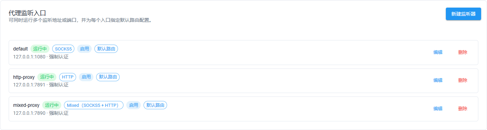
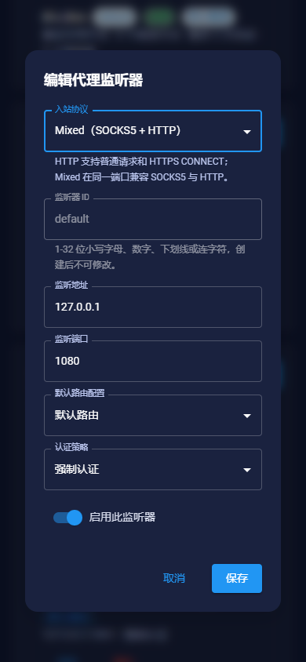

[English](socks5.md) | 简体中文

# 代理网关

SublinkPro 可以将已保存的代理节点通过本地 SOCKS5、HTTP 或 Mixed 监听入口暴露出来。该功能与现有的 SOCKS5 节点导入/导出能力不同。

## 当前包含

- 支持 SOCKS5 TCP `CONNECT`、HTTP/1.x 普通代理请求和 HTTPS `CONNECT` 隧道
- Mixed 入口在同一 TCP 端口接收 SOCKS5 与 HTTP
- 支持 IPv4、IPv6 和域名目标
- 可选用户名/密码认证（默认启用）
- 支持独立 SOCKS5 账号，每个账号拥有单独加密密码并直接绑定路由 Profile
- 支持多个监听地址/端口，监听器具有稳定 ID、默认路由 Profile 和可选认证策略覆盖
- 支持最佳节点、随机节点、轮询节点、P2C 智能负载均衡或指定节点选择
- 支持按多个分组、来源、协议和国家/地区组合过滤候选节点池；不同条件之间为“且”，同一条件内多个值为“或”
- 支持可选的内存粘性会话，可按客户端 IP 或已认证的 SOCKS5 用户名绑定，滑动 TTL 范围为 60-604800 秒
- 支持多个路由 Profile，每个 Profile 可独立配置候选节点池、选路策略、重试、冷却和粘性会话
- 支持向后兼容的用户名选路：`username`、`username@profile` 或 `username@profile.account`
- 按节点 ID 和链接哈希缓存复用 mihomo 出站适配器，并限制空闲 LRU 缓存规模
- 支持每次请求最多 5 个候选节点重试、拨号超时和失败节点冷却
- 指定节点可选失败回退；默认关闭，保持指定节点路由严格性
- 每个监听入口的活动连接上限（`maxConnections`，默认 `256`，范围 `1-10000`）
- 每个监听入口内的单客户端 IP 活动连接上限（`maxConnectionsPerClient`，默认 `32`，范围 `1..maxConnections`）
- 空闲超时（`idleTimeoutSeconds`，默认 `600`，范围 `0-86400`；`0` 表示禁用）
- 单连接最大持续时间（`maxConnectionDurationSeconds`，默认 `0`，范围 `0-604800`；`0` 表示禁用）
- 仅管理员可见的实时监控，展示活动/累计/成功/失败连接数及上下行字节数
- 仅管理员可执行断开单条活动连接或断开全部连接
- 可选节点主动健康探测，提供固定 HTTPS 探测目标、受控并发、延迟统计、指数失败冷却和手动立即探测
- 提供服务端分页的节点负载表，支持搜索、健康状态筛选、排序，并展示活动连接、成功/失败次数、延迟来源和实时智能评分
- 支持重置节点运行统计；清空逐节点历史计数时不会中断活动连接
- 健康感知选路：主动探测失败的节点会退出正常候选集，`best` 会在截取重试节点前优先使用最新主动探测延迟排序
- 保存设置后即时启动/停止，无需重启进程

现有网关设置会自动成为不可删除的 `default` 路由配置；在尚未保存新监听器列表时，旧监听地址和端口会自动映射为兼容的 `default` 监听器，因此升级时不需要迁移数据。其他 Profile 通过认证用户名选择：原始用户名继续使用 `default`；`username@japan` 选择 `japan` Profile 并按客户端 IP 粘性；`username@japan.user01` 选择同一 Profile 并按 `user01` 账号粘性。这些旧版用户名形式仍使用现有网关密码。独立账号使用各自密码，并直接绑定一个已启用的路由 Profile；系统会先精确匹配独立账号，再回退到旧版用户名语法。禁用或不存在的 Profile 会导致认证失败；使用多 Profile 选路必须开启用户名/密码认证。轮询计数和粘性租约在每个监听器运行时内按 Profile 隔离；连接 ID 会包含监听器 ID，网关连接统计则会跨监听器聚合。

智能选路会用 P2C 选择首次尝试节点，综合主动探测延迟（或节点已存延迟）、活动连接负载和连续失败惩罚；其余重试节点按评分排序。粘性命中仍保持第一优先级，智能评分用于回退节点。所有自动切换均发生在发送 SOCKS5 成功响应之前。主动探测失败的节点会在仍有其他可路由节点时被跳过；若全部候选都异常，则采用 fail-open 方式保留候选以便恢复。真实连接成功会解除节点的选路排除状态，同时保留最近一次主动探测延迟。拨号失败的适配器会被丢弃，停止或重新应用网关配置时会关闭适配器池。如果全部候选节点都处于冷却状态，系统会探测最早到期的节点，避免节点池永久不可用。

目前仍不包含 UDP `ASSOCIATE` 和 `BIND`。粘性租约和逐节点选路统计仅保存在内存中，停止网关或重新应用设置后会清空。管理员监控页面同时提供实时连接控制和分页候选节点负载表；重置节点统计不会中断活动连接。

## 配置

1. 使用管理员账号登录。
2. 从侧边栏打开 **系统设置 → 代理网关**。
3. 本机使用请保持监听地址为 `127.0.0.1`。
4. 选择端口（默认 `1080`）和节点选择策略。
5. 可选按分组、来源、协议和国家/地区限制候选节点池；留空表示不限制。指定节点模式仅将这些条件用于失败回退候选。
6. 配置最大尝试次数、单节点拨号超时和失败节点冷却。
7. 配置每个监听入口的连接上限和单客户端连接上限。
8. 配置空闲超时和最大连接时长；设置为 `0` 可禁用对应限制。
9. 可选启用粘性会话，并选择客户端 IP 或已认证的 SOCKS5 用户名作为粘性键。有效期范围为 60-604800 秒，每次连接成功都会刷新。
10. 使用指定节点时，仅在允许切换其他节点的情况下开启失败回退。
11. 保持认证开启，并设置用户名和密码。
12. 可选启用节点主动健康探测，并配置 10-3600 秒的探测间隔和 1-30 秒的单节点超时。
13. 保存设置。监控、健康探测和断开连接操作仅管理员可用。
14. 可在网关设置下方创建路由配置。配置 ID 使用 `japan` 等小写标识，然后通过 `username@japan` 或 `username@japan.account` 连接。
15. 不同客户端需要独立密码时，可创建独立账号并直接绑定到已启用的路由 Profile。
16. 需要额外入口时可新增或编辑监听器，为每个监听地址/端口选择默认 Profile，并选择继承、强制或关闭认证；关闭认证仅允许回环地址。

网关默认关闭。密码使用实例 API 加密密钥加密保存。设置响应仅返回 `hasPassword` 及（有密码时）`maskedPassword`，不会返回明文 `password`。省略 `password` 会保留已保存密码，`clearPassword: true` 会清除密码。

## 使用

```bash
curl --proxy socks5h://127.0.0.1:1080 \
  -U "admin:your-password" \
  https://api.ipify.org
```

如果绑定到 `0.0.0.0` 或其他非回环地址，系统会强制要求认证。请只在防火墙或私有网络后开放，并使用强密码；后端会拒绝未认证的非回环监听，避免意外形成开放代理。

## HTTP 与 Mixed 监听入口

在**代理网关 → 监听入口**中新增或编辑条目，选择**入站协议**：

- **SOCKS5**：保留原有行为。
- **HTTP**：接收目标为完整 `http://` URL 的普通请求，以及 HTTPS `CONNECT` 隧道。同一长连接的每个请求都会重新认证、选路，不会因上次请求而把另一个网站或账号发到错误出口。
- **Mixed**：同一端口接收两种协议；不要为相同地址和端口创建两条监听器。

默认路由配置与认证策略仍按入口设置。旧默认入口继续使用 SOCKS5，也可通过监听入口列表编辑并保存其他协议。旧数据或新建请求缺失协议时默认 `socks5`；旧客户端更新入口时未传协议则保留当前选择，不会降级 HTTP/Mixed。未知协议值会拒绝保存。协议保存在原监听器 JSON 中，不需要新增环境变量或独立代理进程；原有 API/页面路径继续保留 `socks5`，以兼容已有客户端。

假设已创建 `127.0.0.1:7890` 的 Mixed 入口：

```bash
# 通过 HTTP 代理访问普通 HTTP 与 HTTPS 网站
curl --proxy http://127.0.0.1:7890 -U 'proxy:your-password' http://example.com
curl --proxy http://127.0.0.1:7890 -U 'proxy:your-password' https://example.com
# 同一端口也接受 SOCKS5
curl --proxy socks5h://127.0.0.1:7890 -U 'proxy:your-password' https://example.com
```

使用 `HTTP_PROXY` / `HTTPS_PROXY` 的工具，两者的代理地址均填写 `http://127.0.0.1:7890`。HTTPS 网站通过 CONNECT 原样传输，不解密网站内容，也不代表代理入口本身启用了 TLS。HTTP Basic 与 SOCKS5 都不加密认证凭据，非本机入口应放在防火墙、可信内网或安全隧道后。用户名包含 `:` 的旧账号仍可用于 SOCKS5，但无法用 HTTP Basic 表达；HTTP/Mixed 客户端应换用不含冒号的账号。原 `username@profile[.account]` 语法和独立账号的路由规则在两种协议下一致；HTTP 认证失败返回 `407`，不会选取或拨号节点。

自动切换节点仅发生在出站拨号阶段，尚未发送请求数据；POST/上传已开始或响应已部分发送后不会换节点重放。目标网站返回的 HTTP 错误状态不视为节点拨号失败。代理认证头只在本地消费，不转发给目标网站。暂不支持 Upgrade/WebSocket、HTTP/2 入站、UDP/BIND 或代理入口自身的 TLS。

监控区分入口配置的 `mixed` 与连接实际使用的 SOCKS5/HTTP，并标明 CONNECT。连接上限及网关总计按客户端 TCP 连接计数，不按长连接请求次数累加；一条连接完成至少一次普通响应或成功建立隧道后计为成功，后续请求失败不会再次累计该 TCP 连接。逐节点统计按出站连接尝试计数。普通 HTTP 的流量统计为转发的请求/响应正文，隧道统计有效载荷，不包含认证或 HTTP 报头。长连接上的目标、路由配置和节点表示最近一次请求，`idle` 表示等待下一请求。断开、空闲/时长限制以及停止/重新应用设置也覆盖 HTTP 和 CONNECT 连接。底层传输支持半关闭时，隧道在一个方向结束后尽量传完反向数据；不支持时沿用双向关闭。

### 监听入口界面

以下使用合成 API 数据与虚构监听配置演示，不包含真实订阅或认证凭据。





## 备份与恢复

数据库迁移及 WebDAV 恢复会保留目标实例的 SOCKS5 网关配置、账号、监听入口与路由 Profile，避免导入由其他实例密钥加密的凭据或意外开放网络监听。恢复后会断开现有连接并重新加载网关；请按恢复后的节点检查节点 ID 和候选池。

连接数限制分别应用于每个监听入口；连接总计聚合所有入口，健康/路由视图目前展示第一个启用入口的节点运行状态。SOCKS5 本身不提供 TLS，非回环监听应放在防火墙或可信内网后。

## API

以下接口均要求登录并且仅管理员可用；有写入风险的 `POST`/`DELETE` 接口在演示模式下也会被限制。

- `GET /api/v1/settings/socks5` — 读取公开网关设置，不返回明文密码。
- `POST /api/v1/settings/socks5` — 保存并应用设置。JSON 字段包括 `enabled`、`listenAddress`、`port`、`username`、可选 `password`、`clearPassword`、`nodeId`、`selection`（`best`、`random`、`round_robin`、`smart` 或 `specific`）、`requireAuth`、`maxAttempts`（1-5）、`dialTimeoutSeconds`（1-120）、`failureCooldownSeconds`（0-3600）、`specificFallback`、`maxConnections`（1-10000）、`maxConnectionsPerClient`（1..maxConnections）、`idleTimeoutSeconds`（0-86400）、`maxConnectionDurationSeconds`（0-604800）、`healthCheckEnabled`、`healthCheckIntervalSeconds`（10-3600）、`healthCheckTimeoutSeconds`（1-30）、`candidateGroups`、`candidateSources`、`candidateProtocols`、`candidateCountries`、`stickySessionEnabled`、`stickySessionMode`（`client_ip` 或 `username`）和 `stickySessionTtlSeconds`（60-604800）。候选池字段均为字符串数组；不同字段之间为“且”，字段内多个值为“或”。可选字段均可省略，以兼容旧客户端并保留已保存值。
- `POST /api/v1/settings/socks5/stop` — 停止监听，但不修改已保存设置。
- `GET /api/v1/settings/socks5/status` — 返回 `data.config`、`data.listeners`、`data.stats` 和 `data.health`，包含监听器状态、聚合连接统计和健康信息。
- `GET|POST /api/v1/settings/socks5/listeners` — 列出或创建监听器。字段包括 `id`、`protocol`（`socks5` / `http` / `mixed`）、`enabled`、`listenAddress`、`port`、`defaultProfileId` 和可空的 `requireAuth`（null 表示继承网关设置）。
- `PUT|DELETE /api/v1/settings/socks5/listeners/:id` — 覆盖更新或删除监听器。监听器 ID 和已启用的监听端点必须唯一；绑定失败时会回滚已保存的监听器列表。
- `GET|POST /api/v1/settings/socks5/accounts` — 列出或创建独立账号。字段包括 `id`、`username`、`password`、`profileId` 和 `enabled`；响应只返回密码是否存在的元数据。
- `PUT|DELETE /api/v1/settings/socks5/accounts/:id` — 覆盖更新或删除账号；更新时密码留空会保留已加密保存的密码。
- `GET /api/v1/settings/socks5/profiles` — 返回虚拟 `default` 配置和已保存的自定义路由配置。
- `POST /api/v1/settings/socks5/profiles` — 创建自定义路由配置。字段包括 `id`、`name`、`enabled`、`selection`、`nodeId`、重试/冷却参数、候选池数组和粘性设置。
- `PUT /api/v1/settings/socks5/profiles/:id` — 覆盖更新自定义路由配置；保留的 `default` 配置由网关设置接口管理。
- `DELETE /api/v1/settings/socks5/profiles/:id` — 删除自定义路由配置；已经建立的连接不会被主动中断。
- `GET /api/v1/settings/socks5/routing` — 返回服务端分页的候选节点负载数据。查询参数包括 `profileId`、`keyword`、`status`（`healthy`、`unhealthy`、`checking`、`cooling` 或 `unknown`）、`sortBy`、`sortOrder`、`page` 和 `pageSize`（最大 `100`）。每项包含节点元数据、健康状态、延迟来源、活动/成功/失败计数、连续失败、智能评分、冷却时间和最近选择时间。
- `POST /api/v1/settings/socks5/routing/reset` — 清空逐节点成功、失败和最近选择统计，但不主动断开现有连接。
- `POST /api/v1/settings/socks5/health/probe` — 立即启动一轮节点健康探测；已有探测运行时不会重复启动。
- `GET /api/v1/settings/socks5/connections` — 返回当前活动连接数组，每项包含 `id`、`clientAddress`、`target`、`nodeName`、`profileId`、`profileName`、可选 `account`、可选 `listenerId`、`protocol`（识别后为 `socks5` 或 `http`；识别前可能短暂为 `mixed` 或空）、可选 `method`（如 `CONNECT`）、`phase`、`startedAt`、`lastActivity`、`uploadBytes` 和 `downloadBytes`。
- `DELETE /api/v1/settings/socks5/connections/:id` — 按连接 ID 断开一条活动连接。
- `DELETE /api/v1/settings/socks5/connections` — 断开全部活动连接。

状态统计、逐节点选路统计、活动连接列表和粘性租约仅属于当前网关进程生命周期；停止或重新应用设置后会清空这些内存状态。节点负载接口在服务端完成筛选、排序和分页，使页面三秒刷新时只渲染当前请求页。

主动健康探测会对所有已启用路由 Profile 的候选节点取并集并去重。严格指定节点 Profile 只贡献指定节点；开启指定节点回退的 Profile 会贡献指定节点及回退池；其他 Profile 贡献各自配置后的候选节点池。探测固定使用 Cloudflare HTTPS 连通性检测地址，不允许管理员配置任意探测 URL。每轮最多使用 4 个 worker 且不会重叠；状态响应包含完整聚合计数，但最多返回排序后的前 200 条节点记录，避免三秒轮询产生过大响应；失败探测会安全淘汰对应适配器租约，并使用最长一小时的指数冷却。
