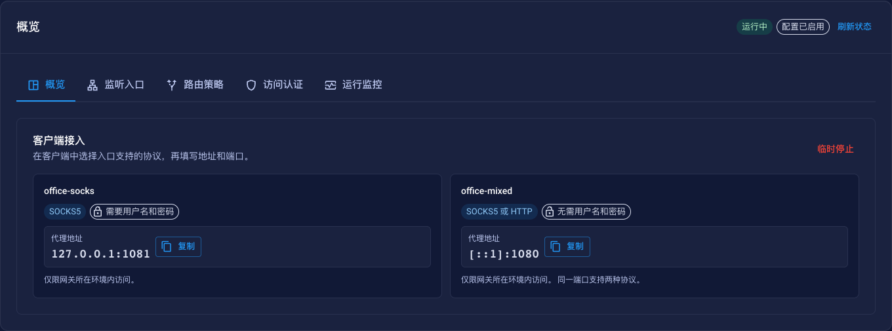
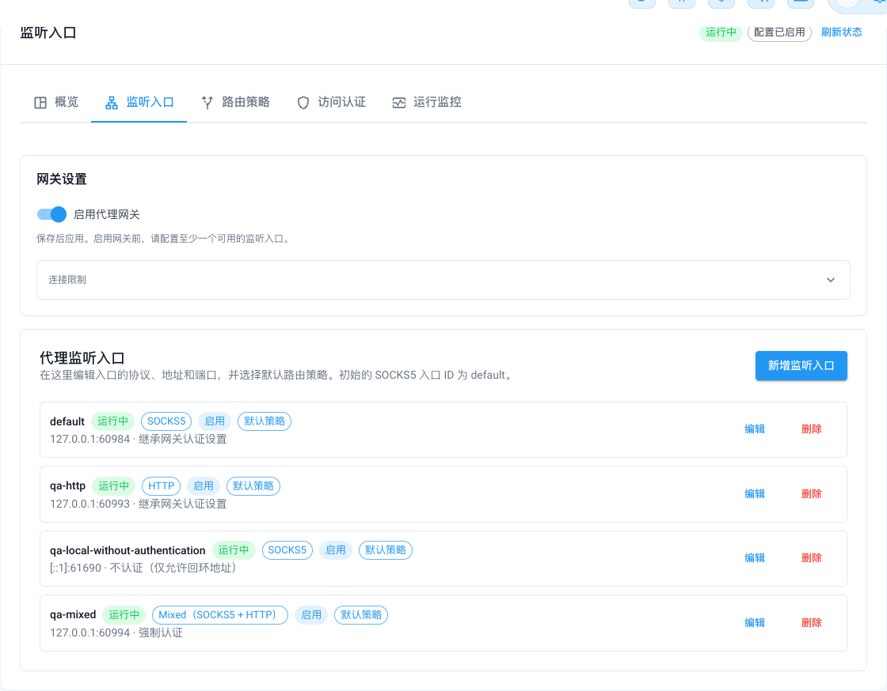
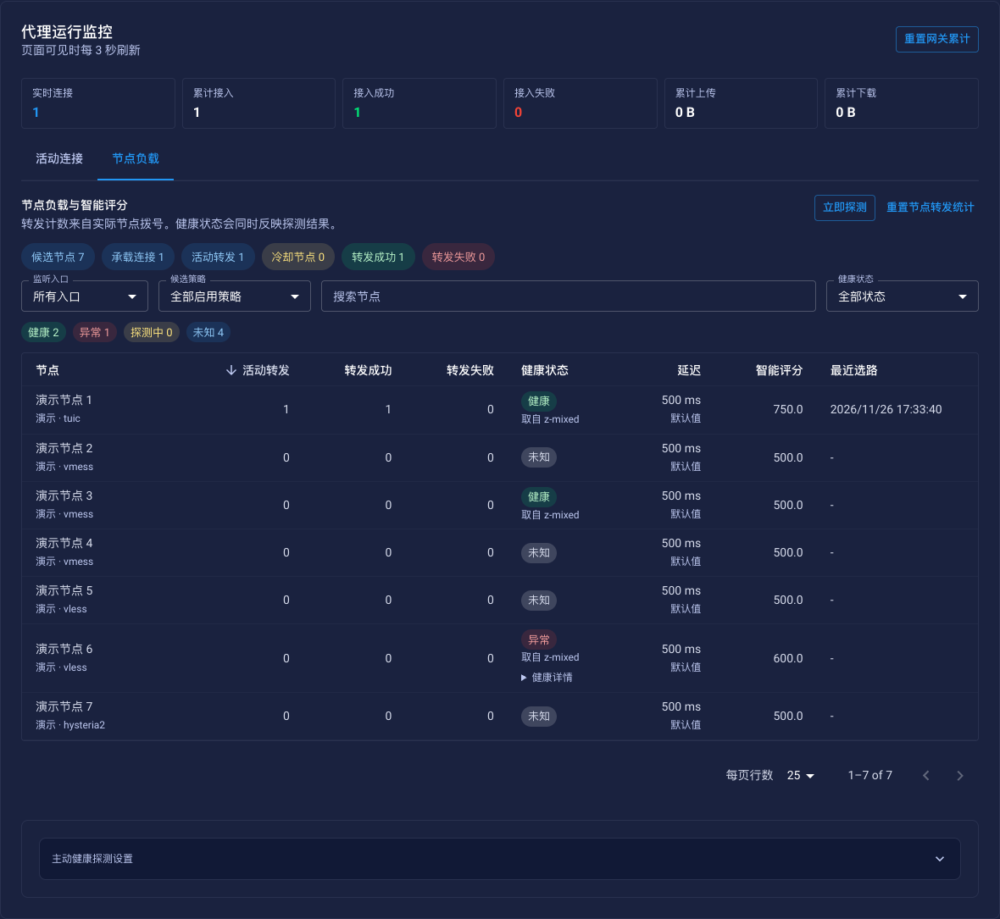

English | [简体中文](proxy-gateway.zh-CN.md)

[Guide index](../README.md)

# Proxy Gateway

The proxy gateway forwards client traffic through nodes already stored in SublinkPro. A **listener** determines the address, port, and protocol clients connect to. A **routing policy** determines which nodes the gateway can use and how it selects one. **Sticky sessions** give the last successful outbound node priority for the same client while its binding is valid.

## Set up a listener

1. As an administrator, open **System Settings → Proxy gateway**. The gateway starts disabled. Its initial SOCKS5 listener has the ID `default` and uses `127.0.0.1:1080`. You can edit it in place.
2. Under **Access → Shared authentication**, turn on **Require username/password**. Set the shared username to `test` and choose a password. Use these proxy credentials in the client.
3. Under **Listeners**, enable an entry. The examples use a **Mixed** listener on `127.0.0.1:7890` with **Require authentication** and `default` as its default routing policy.
4. Under **Routing**, choose an available outbound node or configure the candidate pool for the default policy. In **Listeners**, turn on **Enable proxy gateway**, select **Save and apply**, then verify the listener is running in **Overview**.

| Inbound protocol | Client proxy address | Supported requests |
| --- | --- | --- |
| SOCKS5 | `socks5h://127.0.0.1:7890` (curl) | SOCKS5 TCP CONNECT to domains and IPv4 or IPv6 addresses |
| HTTP | `http://127.0.0.1:7890` | Ordinary HTTP requests and CONNECT tunnels to HTTPS sites |
| Mixed | Either address above, on the same port | SOCKS5 and HTTP |

With `socks5h://`, curl sends the destination hostname to the proxy. For an HTTP listener, use an `http://` proxy address even when the destination is an HTTPS site. HTTP CONNECT preserves TLS between the client and the destination. The gateway supports SOCKS5 TCP CONNECT and HTTP/1.x. Inbound TLS, HTTP/2, HTTP Upgrade (including WebSocket), and SOCKS5 UDP/BIND are unsupported.

Use `127.0.0.1` when the client shares the gateway's loopback interface. Non-loopback listeners require authentication. SOCKS5 username/password authentication and HTTP Basic send client credentials to the gateway without encryption. Use a trusted private network or a secure tunnel.

## Choose a routing policy by username

On a listener that requires authentication, use any of these shared username formats with the same password from **Shared authentication**.

| Client username | Routing policy | When sticky sessions are enabled |
| --- | --- | --- |
| `test` | The listener's default routing policy. If the listener's default is set to `japan`, plain `test` uses `japan`. | For the built-in `default` policy, uses the sticky key set in **Advanced routing**. For a custom policy assigned to the listener, uses the client IP. |
| `test@japan` | The policy with ID `japan`. | Uses the client IP seen by the gateway. Clients behind the same NAT share a binding if they reach the gateway with the same IP. |
| `test@japan.user01` | The same `japan` policy. | Uses `user01` as the client identifier. Within the same listener and policy, the identifier can reuse its binding after the client's IP changes. |
| `test@default` | The built-in `default` policy, even if the listener defaults to a custom policy. | Uses the client IP regardless of the sticky-key setting for the plain shared username. Use `test@default.user01` for identifier-based affinity. |

After `@`, use the enabled policy's **Profile ID**, such as `japan`. Its display name can be “Japan egress”. An ID is 1–32 characters, starts with a letter or digit, and uses lowercase letters, digits, underscores, or hyphens. An unknown or disabled policy or an incorrect password causes authentication to fail. An HTTP proxy returns `407 Proxy Authentication Required`. A listener with authentication disabled always uses its default routing policy.

If clients need separate passwords, create an account such as `reporter` under **Access → Proxy accounts** and assign it to `japan`. Enter `reporter` and that account's own password in the client. The gateway checks for an independent account first and uses the account as the sticky key when its policy has sticky sessions enabled. The `user01` suffix on a shared username is a client-chosen identifier. Other clients with the same shared credentials can use the same identifier. HTTP Basic usernames cannot contain a colon.

## Enable sticky sessions

- **Built-in `default` policy**. Open **Routing → Default routing policy → Advanced routing** and turn on **Enable sticky sessions**. For clients that supply the plain shared username, set the sticky key to **Client IP** or **Proxy username**, then select **Save and apply**. With **Proxy username**, all clients that supply the same plain shared username share a binding.
- **Custom policy**. Create or edit a policy under **Routing → Custom policies**. Turn on **Keep the outbound by Profile.Account**, set the **Sticky TTL (seconds)**, and save. Use `test@japan.user01` and `test@japan.user02` to keep separate bindings for clients sharing a listener, policy, and password.

The first successful outbound dial records the node for that identity. The TTL can be **60–604800 seconds** and defaults to **1800 seconds** in the form. Each successful outbound dial refreshes the TTL. For example, with a 600-second TTL, a successful dial after five minutes extends the binding for ten minutes from that dial. After expiry, the next connection selects a node using the policy again and may pick the same one. Bindings are scoped to each listener and routing policy. SOCKS5 and HTTP on the same Mixed listener can reuse the same binding.

A sticky session gives priority to an **outbound node**. If that node leaves the candidate pool, is skipped due to health or cooldown, or fails to dial, the gateway can try another candidate within the attempt limit. The next successful dial updates the binding. Stopping, restarting, or reapplying the gateway clears its in-memory bindings. **Specific node** mode does not use sticky sessions, including when fallback is enabled.

## Verify policies and egress with curl

Under **Custom policies**, create and enable a policy with the ID `japan`. Filter countries/regions to Japan, select **Round-robin nodes**, turn on **Keep the outbound by Profile.Account**, and set the TTL to **600 seconds**. Use at least two available candidates to observe how separate sessions are routed. Replace `your-shared-password` and `your-account-password` with the passwords you configured. The curl option `--proxy-user` (short form `-U`) supplies credentials to the proxy. The option `--noproxy ''` prevents a `NO_PROXY` environment setting from bypassing it.

```bash
# SOCKS5 with the listener's default policy
curl --noproxy '' -fsS --proxy socks5h://127.0.0.1:7890 \
  --proxy-user 'test:your-shared-password' https://api.ipify.org

# HTTPS over the HTTP proxy, explicitly selecting japan with client-IP affinity
curl --noproxy '' -fsS --proxy http://127.0.0.1:7890 \
  --proxy-user 'test@japan:your-shared-password' https://api.ipify.org
```

Each iteration starts a fresh curl process. The first two requests use the same identifier and should prefer the same available outbound node. The third uses `user02`, selects a node independently, and remembers its own result.

```bash
for proxy_user in test@japan.user01 test@japan.user01 test@japan.user02; do
  printf '%s → ' "$proxy_user"
  curl --noproxy '' -fsS --proxy socks5h://127.0.0.1:7890 \
    --proxy-user "$proxy_user:your-shared-password" https://api.ipify.org
  printf '\n'
done
```

Two identities can select the same node, and different nodes can share a public IP. To confirm which node a request used, check the policy and node under **Monitor → Active connections** while the request is open, or compare each node's successful forwarding count under **Node load**.

If you enabled the independent account `reporter` and assigned it to `japan`, use it to reach an ordinary HTTP site. This command can use the same Mixed port as the HTTPS example.

```bash
curl --noproxy '' -fsS --proxy http://127.0.0.1:7890 \
  --proxy-user 'reporter:your-account-password' http://example.com
```

## Candidate pools, retries, and monitoring

- **Combine filters**. A node must match every configured filter across groups, sources, protocols, countries/regions, and tags. Within a filter, any selected value can match. For example, choosing Japan and the tags `stable` and `low-latency` returns Japanese nodes with either tag. Tag names match exactly, including case. An empty filter allows all values.
- **Choose a selection strategy**. Best available node uses active-probe latency when available. Smart load balancing (P2C) weighs measured or stored latency, active connections, and consecutive failures. Use round-robin to cycle the first choice for new sessions. To prefer a specific node with failover, choose **Specific node**, turn on **Try other nodes if the specific node fails**, and allow at least two attempts. Candidate-pool filters apply to fallback nodes.
- **Retry outbound dials**. The gateway allows 1–5 candidate attempts, each with its own dial timeout. It can retry while dialing, before any application data is forwarded. An HTTP error from the destination does not trigger a dial retry. Every request on an HTTP keep-alive connection authenticates and selects a route again.
- **Monitor health and limit connections**. Under **Monitor → Node load**, enable active health checks, run a check immediately, or filter results by listener and candidate policy. Failed probes exclude nodes while usable alternatives remain. Under **Listeners → Connection limits**, set the active-connection limit per listener and per client IP, idle timeout, and maximum connection duration. **Monitor → Active connections** shows the listener, actual protocol, destination, policy, and node, and lets you disconnect one or all active connections.

### Interface preview







[Mixed listener editor on mobile](../../images/proxy-gateway/mixed-mobile-dark.png) · [Light-mode monitoring](../../images/proxy-gateway/monitor-light.png)
