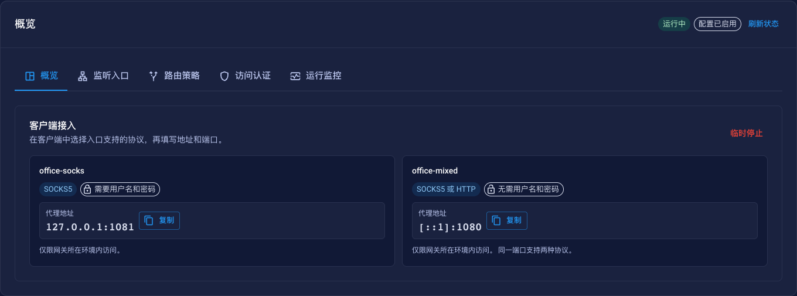
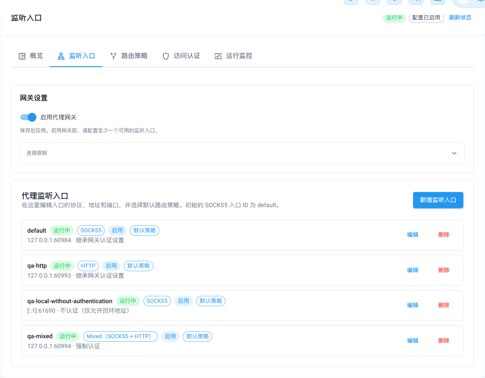
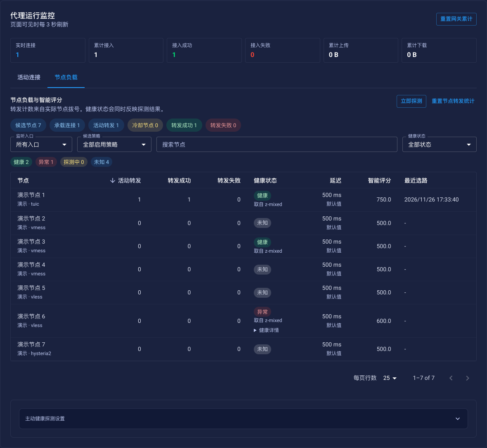

[English](proxy-gateway.md) | 简体中文

[返回指南目录](../README.zh-CN.md)

# 代理网关

代理网关通过 SOCKS5、HTTP 或 Mixed 监听入口，把客户端流量转发到 SublinkPro 中已有的代理节点。**监听入口**决定客户端连哪个地址和端口，**路由策略**决定网关从哪些节点中选出口，**粘性会话**让同一客户端在有效期内优先复用上次成功的出站节点。

## 配置监听入口

1. 用管理员账号打开 **系统设置 → 代理网关**。网关默认关闭，初始 SOCKS5 入口的 ID 为 `default`，地址为 `127.0.0.1:1080`。可直接编辑该入口。
2. 在 **访问认证 → 共享认证** 打开 **要求用户名/密码**，设置共享用户名 `test` 和自己的密码。填写客户端时，使用这里的代理凭据。
3. 在 **监听入口** 启用一个入口。本文示例使用 `127.0.0.1:7890` 上的 **Mixed** 入口，认证策略选 **强制认证**，默认路由策略选 `default`。
4. 在 **路由策略** 为默认策略选择可用的出站节点或候选节点池。在 **监听入口** 打开 **启用代理网关**，点击 **保存并应用**，然后在 **概览** 确认入口正在运行。

| 入站协议 | 客户端代理地址 | 支持的请求 |
| --- | --- | --- |
| SOCKS5 | `socks5h://127.0.0.1:7890`（curl） | SOCKS5 TCP CONNECT，支持域名及 IPv4、IPv6 |
| HTTP | `http://127.0.0.1:7890` | 普通 HTTP 请求、访问 HTTPS 网站的 CONNECT 隧道 |
| Mixed | 以上任一地址，使用同一个端口 | SOCKS5 和 HTTP |

`socks5h://` 让 curl 把目标域名交给代理。HTTP 入口即使用于访问 HTTPS 网站，代理地址仍填写 `http://`。HTTP CONNECT 保留客户端与目标网站之间的 TLS。网关入口当前只支持 SOCKS5 TCP CONNECT 和 HTTP/1.x，不支持入口 TLS、HTTP/2、HTTP Upgrade（含 WebSocket）或 SOCKS5 UDP/BIND。

客户端和网关共用同一个回环网络接口时，可使用 `127.0.0.1`。非回环入口必须启用认证。SOCKS5 用户名/密码认证和 HTTP Basic 都以未加密的方式向网关传递凭据，请通过可信内网或安全隧道使用。

## 用用户名选择路由策略

在要求认证的入口，共享用户名有以下写法。所有写法都使用在 **共享认证** 中设置的同一个密码。

| 客户端用户名 | 使用的路由策略 | 当策略启用粘性会话时 |
| --- | --- | --- |
| `test` | 当前监听入口的默认路由策略。把入口默认策略改为 `japan` 后，`test` 也会走 `japan`。 | 若入口默认策略为内置 `default`，使用 **高级选路** 中设置的粘性键。若入口绑定自定义策略，则按客户端 IP。 |
| `test@japan` | ID 为 `japan` 的策略。 | 按网关看到的客户端 IP 绑定出口。多个客户端如果经过同一个 NAT 并以相同 IP 到达网关，会共享这条绑定。 |
| `test@japan.user01` | 同一个 `japan` 策略。 | 按 `user01` 绑定出口。同一入口和策略内，客户端更换 IP 仍可用同一个标识复用绑定。 |
| `test@default` | 显式使用内置 `default`，可覆盖入口分配的自定义默认策略。 | 按客户端 IP，和内置默认策略为裸用户名设置的粘性键无关。也可用 `test@default.user01` 按标识绑定。 |

`@` 后填写的是已启用策略的**配置 ID**，例如 `japan`，而显示名称可以是“日本出口”。策略 ID 为 1–32 个字符，以字母或数字开头，可使用小写字母、数字、下划线和连字符。ID 不存在、策略已停用或密码错误时，认证会失败。HTTP 代理会返回 `407 Proxy Authentication Required`。无需认证的入口始终使用该入口的默认路由策略。

如果每个客户端需要自己的密码，在 **访问认证 → 独立账号** 新建账号，例如 `reporter`，再将其绑定到 `japan`。客户端只填 `reporter` 和该账号自己的密码。网关优先匹配独立账号，策略启用粘性时按账号绑定出口。共享用户名末尾的 `user01` 只是客户端自行选择的标识，持有同一组共享凭据的客户端可以使用相同的标识。HTTP Basic 的用户名不能包含冒号。

## 开启粘性会话

- 配置**内置 `default` 策略**时，打开 **路由策略 → 默认策略 → 高级选路**，开启 **启用粘性会话**，为直接填写共享用户名的客户端选择 **客户端 IP** 或 **代理用户名**，然后 **保存并应用**。使用 **代理用户名** 时，多个客户端直接填写同一个共享用户名会共享绑定。
- 配置**自定义策略**时，在 **路由策略 → 自定义策略** 新建或编辑策略，打开 **按 Profile.Account 保持出口**，填写 **粘性有效期（秒）** 后保存。可用 `test@japan.user01`、`test@japan.user02` 为共享同一个入口、策略和密码的两个客户端分别维持绑定。

首次拨号成功后，网关会记住该标识使用的节点。有效期范围为 **60–604800 秒**，表单默认 **1800 秒**。每次出站拨号成功都会重新计时。比如设为 600 秒，5 分钟后的成功拨号会将到期时间延长到该次拨号之后 10 分钟。超过有效期后，新连接会按策略重新选节点，仍有可能选到同一个节点。租约按监听入口和路由策略隔离，同一个 Mixed 入口上的 SOCKS5 和 HTTP 可复用同一条租约。

粘性会话优先复用**出站节点**。如果该节点被移出候选池、因健康状态或冷却被跳过，或者出站拨号失败，网关在可用候选和最大尝试次数内重新选路，成功后将绑定更新到新的节点。停止、重启或重新应用网关设置会清空内存中的租约。**指定节点**模式不使用粘性会话，开启失败回退时也一样。

## 用 curl 验证策略和出口

先在 **自定义策略** 创建并启用 ID 为 `japan` 的策略，按国家/地区筛选日本节点，选择 **轮询可用节点**，开启 **按 Profile.Account 保持出口**，把粘性有效期设为 **600 秒**。准备至少两个可用候选节点，以便观察不同会话的选路。下文的 `your-shared-password` 和 `your-account-password` 均为占位值，请替换为设置的密码。curl 的 `--proxy-user`（简写 `-U`）为代理提供凭据，`--noproxy ''` 确保示例请求不会因环境中的 `NO_PROXY` 而绕过网关。

```bash
# SOCKS5，使用监听入口的默认策略
curl --noproxy '' -fsS --proxy socks5h://127.0.0.1:7890 \
  --proxy-user 'test:your-shared-password' https://api.ipify.org

# HTTP 代理访问 HTTPS 网站，显式选择 japan，按客户端 IP 粘性
curl --noproxy '' -fsS --proxy http://127.0.0.1:7890 \
  --proxy-user 'test@japan:your-shared-password' https://api.ipify.org
```

下面每次启动新的 curl 进程。前两次使用同一个标识，且节点健康时应优先使用同一个出站节点。第三次使用 `user02`，会单独选路并记住自己的出口。

```bash
for proxy_user in test@japan.user01 test@japan.user01 test@japan.user02; do
  printf '%s → ' "$proxy_user"
  curl --noproxy '' -fsS --proxy socks5h://127.0.0.1:7890 \
    --proxy-user "$proxy_user:your-shared-password" https://api.ipify.org
  printf '\n'
done
```

两个标识仍可能选中同一节点，不同节点也可能共享公网 IP。需要确认具体使用哪个节点时，在 **运行监控 → 活动连接** 查看仍在进行的请求所用的策略和节点，或在 **节点负载** 对照各节点的成功计数。

如已创建并启用绑定 `japan` 的独立账号 `reporter`，可使用它访问普通 HTTP 网站。该命令和上面的 HTTPS 命令可以连同一个 Mixed 端口。

```bash
curl --noproxy '' -fsS --proxy http://127.0.0.1:7890 \
  --proxy-user 'reporter:your-account-password' http://example.com
```

## 候选池、重试与监控

- **组合筛选候选节点**时，分组、来源、协议、国家/地区、标签之间同时生效。同一项内匹配任意一个值即可。例如选择「日本」并选中 `稳定`、`低延迟` 两个标签，会得到带任一所选标签的日本节点。标签按完整名称和大小写匹配，留空表示该字段不限。
- **节点选择**决定新会话如何挑选出口。最佳可用节点优先参考主动探测延迟。智能负载均衡（P2C）综合探测或已保存的延迟、活动连接数和连续失败情况。需要每个新会话轮流选择节点可用轮询。如需优先走固定节点并允许故障切换，选 **指定节点**，打开 **指定节点失败时尝试其他节点**，并将最大尝试次数设为至少 2。候选池筛选用于回退节点。
- **拨号重试**最多尝试 1–5 个候选节点，超时按节点计算。重试发生在出站拨号阶段，已经开始转发的数据不会自动换节点重发。目标网站返回 HTTP 错误也不会触发拨号重试。同一 HTTP 持久连接上的每个请求都会重新认证和选路。
- 在 **运行监控 → 节点负载** 可启用主动健康探测、立即探测，或按监听入口和候选策略查看结果。探测失败的节点在有可用替代节点时会被跳过。在 **监听入口 → 连接限制** 可设置每个入口的活动连接数、同一客户端 IP 的连接数、空闲超时和最大连接时长。**运行监控 → 活动连接** 可查看入口、实际协议、目标、策略和节点，并断开单条或全部活动连接。

### 界面预览







[手机端 Mixed 入口编辑](../../images/proxy-gateway/mixed-mobile-dark.png) · [浅色模式运行监控](../../images/proxy-gateway/monitor-light.png)
